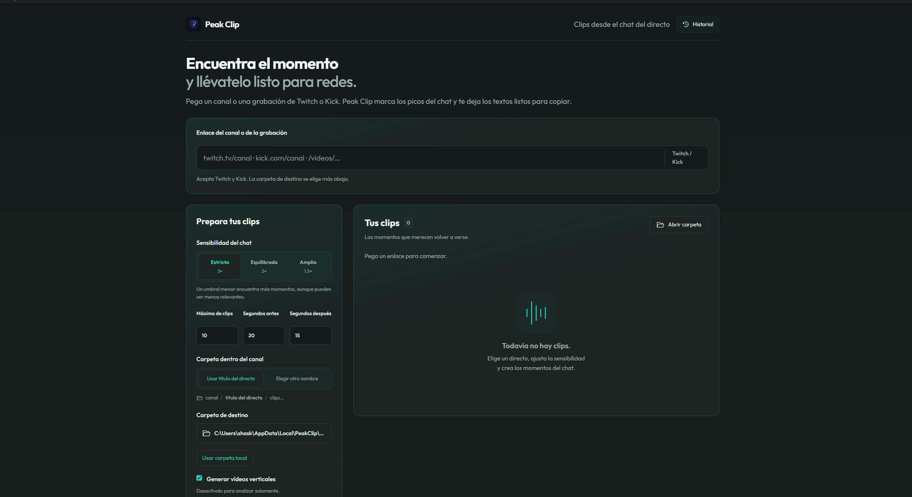

# Peak Clip

<p align="center">
  
</p>

<p align="center">
  <strong>Clips verticales listos para redes a partir de los picos del chat</strong><br>
  Twitch · Kick · Windows
</p>

<p align="center">
  <a href="https://github.com/EricCarballo/peakclip/releases/latest"></a>
  
  
</p>

## Descargar e instalar

No hace falta instalar Python, Node ni herramientas extra.

1. Abre la [última release](https://github.com/EricCarballo/peakclip/releases/latest)
2. Descarga **`Peak-Clip-portable-windows.zip`**
3. Descomprime la carpeta donde quieras (por ejemplo el Escritorio)
4. Entra a `Peak Clip` y abre **`Peak Clip.exe`**

Importante: deja juntas las carpetas `_internal` y `tools` junto al `.exe`. No borres ni muevas solo el ejecutable.

La carpeta `tools` ya incluye `ffmpeg`, `yt-dlp` y `TwitchDownloaderCLI`.

## Cómo usarlo

1. Pega el enlace de un canal o VOD de **Twitch** o **Kick**
2. Elige una grabación **ya terminada** (en Kick, los que siguen en vivo no sirven)
3. Elige carpeta de destino y ajusta cantidad / sensibilidad si quieres
4. (Opcional) Activa **Añadir subtítulos** y elige una plantilla: En foco, Impacto, Editorial o Contraste
5. Pulsa generar clips
6. Cuando termine, abre la carpeta de salida: ahí están los MP4 verticales **1080×1920** y los textos para copiar a redes

### Subtítulos

- También puedes abrir **Añadir subtítulos / Editar subtítulos** en cualquier clip terminado (o del historial)
- Transcribe en tu equipo (sin coste de API). La primera vez descarga el modelo de voz; luego funciona sin conexión
- Corrige frases y tiempos, cambia tamaño/color/posición/animación y usa **Renderizar muestra** (hasta 8 s) para ver el acabado real
- **Exportar subtitulado** crea un MP4 nuevo y conserva el original; también genera SRT y ASS
- Guardar texto no actualiza un MP4 anterior: vuelve a exportar para aplicar correcciones
- Las correcciones viven junto al clip y sobreviven a **Borrar chat y temporales**
- **Ver clip**, mostrar en carpeta y publicar usan la última versión subtitulada si existe

Consejos rápidos:

- En Kick, si un directo sigue en vivo, espera a que termine y vuelve a cargar el canal
- Si Windows bloquea el `.exe` la primera vez, usa “Más información” → “Ejecutar de todos modos”
- No cierres la app mientras descarga el chat o corta los clips; si se interrumpe, puedes reanudar



---

## Para desarrolladores

La estructura y contratos de subtítulos están en [Arquitectura](docs/architecture.md).

```text
src/peakclip/   # aplicación Python
frontend/       # React + Vite
tests/          # pruebas
scripts/        # build portable
packaging/      # PyInstaller
```

```bash
npm --prefix frontend install
npm run build

python -m venv .venv
.venv\Scripts\pip install -r requirements.txt
set PYTHONPATH=src
.venv\Scripts\python -m peakclip
```

Pruebas:

```bash
set PYTHONPATH=src
.venv\Scripts\python -m unittest discover -s tests -v
```

Empaquetar:

```bash
powershell -ExecutionPolicy Bypass -File .\scripts\build_portable.ps1
```

## Licencia

Uso personal / compartir con amigos. Twitch, Kick y las herramientas de terceros conservan sus licencias.
